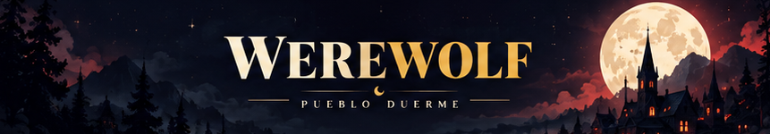
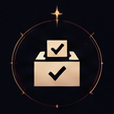
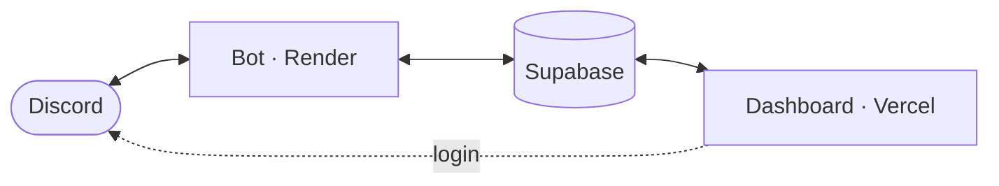
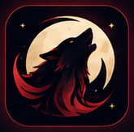

  

<i>The village sleeps. Suspicion wakes.</i>

  <a href="https://discord.com/oauth2/authorize?client_id=1386739677729652888&scope=bot+applications.commands&permissions=2252074960251968"><b>Add to Discord</b></a>
  &nbsp;·&nbsp;
  <a href="https://werewolfdashboard.vercel.app">Website</a>
  &nbsp;·&nbsp;
  <a href="https://werewolfdashboard.vercel.app/roles">Roles</a>
  &nbsp;·&nbsp;
  <a href="https://werewolfdashboard.vercel.app/dashboard">Dashboard</a>
  &nbsp;·&nbsp;
  <a href="docs/technical-case.md">Technical case</a>
  &nbsp;·&nbsp;
  <a href="README.md">Español</a>

Werewolf is a Discord bot for playing Werewolf without a narrator. It deals roles by direct message, runs night and day in the server channel, counts the votes and keeps a per-server leaderboard. The bot and its interface are in Spanish.

This repository is the project's showcase. The source code is private.

<table>
  <tr>
    <td width="50%" align="center" valign="top"> <b>28 roles</b> Each player gets theirs in private.</td>
    <td width="50%" align="center" valign="top"> <b>Three modes</b> Ranked, Casual and One Night.</td>
  </tr>
  <tr>
    <td width="50%" align="center" valign="top"> <b>Voting in the channel</b> Every day the village decides who to eliminate.</td>
    <td width="50%" align="center" valign="top"> <b>5 to 20 players</b> One Night: 3 to 10.</td>
  </tr>
  <tr>
    <td width="50%" align="center" valign="top"> <b>Per-server ranking</b> Profiles, achievements and statistics.</td>
    <td width="50%" align="center" valign="middle"><a href="https://werewolfdashboard.vercel.app/roles"><b>See all 28 roles</b></a> Encyclopedia on the website.</td>
  </tr>
</table>

## How a game works

1. Someone opens the lobby with `/start` and the others join with `/join`.
2. Each player receives a role by direct message.
3. At night, roles with abilities act. By day the village debates and votes on who to eliminate.
4. The game ends when a side meets its goal, and the bot records the result.

Commands work as slash commands, by mentioning the bot, or with the `ww!` prefix, which each server can change. `/help` lists them all.

## Modes

- **Ranked.** The classic game. It counts toward the server leaderboard.
- **Casual.** Looser and more chaotic. It does not count.
- **One Night.** A single night, 3 to 10 players, with its own roles.

The bot builds the deck from the player count and what each role contributes. It is a calculated split, not a guarantee of a balanced game: the outcome still depends on how people play.

## Dashboard

The [dashboard](https://werewolfdashboard.vercel.app/dashboard) signs in with Discord. Everyone sees their profile and game history for their servers. Server admins can also change settings from the browser and review reports, including the game channel, a ping role for `/mention`, a "Playing" role during games, win-streak roles, muting eliminated players, locking the channel while voting, and optional UnbelievaBoat coin rewards.

## Get started

1. [Invite the bot](https://discord.com/oauth2/authorize?client_id=1386739677729652888&scope=bot+applications.commands&permissions=2252074960251968) to your server.
2. Type `/help` to see the commands.
3. Open a game with `/start`.

The bot does not ask for the Administrator permission. For the `ww!` prefix it uses the privileged Message Content intent, only to recognise commands; it does not store message text. See the [privacy policy](https://werewolfdashboard.vercel.app/privacy) and the [terms](https://werewolfdashboard.vercel.app/terms).

## About the project

Werewolf is under active development. Published changes are in the [changelog](https://werewolfdashboard.vercel.app/cambios).

- **Bot:** Python with discord.py. Each role has its own night logic, separate from the rest of the engine.
- **Dashboard:** Next.js 16 (App Router) and React 19, with Discord sign-in (Auth.js).
- **Data:** Supabase (PostgreSQL), shared by the bot and the dashboard, with statistics stored per server.
- **Balance:** a Monte Carlo simulation plays games with random role splits to measure how each side wins at each table size.
- **Fault tolerance:** if Discord denies a permission, the game carries on and the bot logs it instead of stopping.
- **Quality:** every change goes through a pull request with automated checks (compilation, tests and simulation) before reaching the main branch.

The [technical case](docs/technical-case.md) describes four concrete problems from the project and how they were solved, including what is still open.

   
  © 2026 Werewolf. All rights reserved. 
  Independent project, not affiliated with Discord or UnbelievaBoat. Discord is a trademark of Discord Inc.

