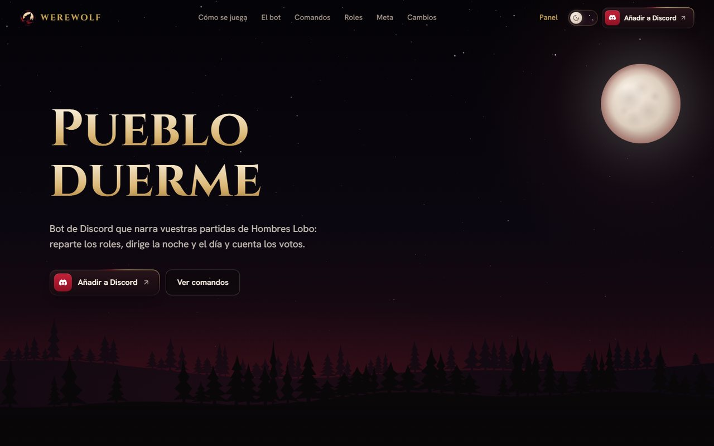
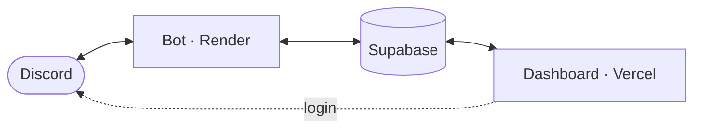

  

<i>El pueblo duerme. La sospecha despierta.</i>

  <a href="https://discord.com/oauth2/authorize?client_id=1386739677729652888&scope=bot+applications.commands&permissions=2252074960251968"><b>Añadir a Discord</b></a>
  &nbsp;·&nbsp;
  <a href="https://werewolfdashboard.vercel.app">Web</a>
  &nbsp;·&nbsp;
  <a href="https://werewolfdashboard.vercel.app/roles">Roles</a>
  &nbsp;·&nbsp;
  <a href="https://werewolfdashboard.vercel.app/dashboard">Dashboard</a>
  &nbsp;·&nbsp;
  <a href="docs/caso-tecnico.md">Caso técnico</a>
  &nbsp;·&nbsp;
  <a href="README.en.md">English</a>

Werewolf es un bot de Discord para jugar a Hombres Lobo sin narrador. Reparte los roles por mensaje privado, lleva la noche y el día en el canal del servidor, cuenta los votos y guarda el resultado en un ranking por servidor.

Este repositorio es su escaparate. El código fuente es privado.

<table>
  <tr>
    <td width="50%" align="center" valign="top"> <b>28 roles</b> Cada jugador recibe el suyo en privado.</td>
    <td width="50%" align="center" valign="top"> <b>Tres modos</b> Ranked, Casual y One Night.</td>
  </tr>
  <tr>
    <td width="50%" align="center" valign="top"> <b>Votación en el canal</b> Cada día el pueblo decide a quién eliminar.</td>
    <td width="50%" align="center" valign="top"> <b>De 5 a 20 jugadores</b> One Night, de 3 a 10.</td>
  </tr>
  <tr>
    <td width="50%" align="center" valign="top"> <b>Ranking por servidor</b> Perfiles, logros y estadísticas.</td>
    <td width="50%" align="center" valign="middle"><a href="https://werewolfdashboard.vercel.app/roles"><b>Ver los 28 roles</b></a> Enciclopedia en la web.</td>
  </tr>
</table>

  <a href="https://werewolfdashboard.vercel.app"><picture>
    <source media="(prefers-color-scheme: light)" srcset="assets/web/landing-dia.jpg">
    
  </picture></a>

La web tiene fase de noche y de día; el interruptor del encabezado cambia entre ambas.

## Cómo es una partida

1. Alguien abre el lobby con `/start` y los demás entran con `/join`.
2. Cada jugador recibe su rol por mensaje privado.
3. De noche actúan los roles con habilidad. De día el pueblo debate y vota a quién eliminar.
4. La partida termina cuando un bando cumple su objetivo, y el bot anota el resultado.

Los comandos funcionan como comandos de barra (`/`), con mención al bot o con el prefijo `ww!`, que cada servidor puede cambiar. `/help` muestra la lista completa.

## Modos

- **Ranked.** La partida clásica y competitiva: voto siempre anónimo y recompensas del servidor (rachas y monedas, si están activadas).
- **Casual.** Mismas reglas y reparto, con anonimato opcional y sin recompensas del servidor.
- **One Night.** Una sola noche, de 3 a 10 jugadores y roles propios. Tu carta la ves con un botón y solo la ves tú. Todos actúan a la vez, el debate puede acabar antes si todos están listos y el voto es secreto. Al final, el bot cuenta qué pasó de verdad: robos, intercambios, cartas finales y quién votó a quién.

El bot arma el mazo según el número de jugadores y lo que aporta cada rol. El reparto está calculado, pero el equilibrio de cada partida depende de cómo se juegue.

La [enciclopedia de roles](https://werewolfdashboard.vercel.app/roles) explica los 28 roles clásicos y los 11 de One Night, con su texto completo y un consejo de juego. [Meta y balance](https://werewolfdashboard.vercel.app/meta) muestra con qué frecuencia sale cada rol según el número de jugadores, calculado con el mismo reparto que usa el bot, y deja ver una mesa de ejemplo.

## Dashboard

El [dashboard](https://werewolfdashboard.vercel.app/dashboard) usa el inicio de sesión de Discord. Cada persona ve su perfil y el historial de partidas de sus servidores. Quien administra un servidor puede además cambiar sus ajustes desde el navegador y revisar los reportes:

- elegir el canal de las partidas y un rol de aviso que `/mention` llama a jugar;
- dar un rol «Jugando» mientras dura la partida y roles por racha de victorias;
- silenciar en el canal a los jugadores eliminados;
- cerrar el canal mientras se vota y, si lo activan, durante la noche;
- activar recompensas de monedas con UnbelievaBoat.

Para gestionar roles, el rol del bot tiene que estar por encima de los roles que asigna.

## Empezar

1. [Invita el bot](https://discord.com/oauth2/authorize?client_id=1386739677729652888&scope=bot+applications.commands&permissions=2252074960251968) a tu servidor.
2. Escribe `/help` para ver los comandos.
3. Abre una partida con `/start`.

¿Qué permisos pide el bot?

No pide permiso de Administrador.

- **Ver canales, enviar mensajes, insertar enlaces y leer el historial.** Para llevar la partida y las votaciones.
- **Gestionar roles.** Para el rol «Jugando», los roles por racha, silenciar a los eliminados y cerrar el canal en las fases que lo piden.
- **Gestionar mensajes, fijar mensajes y añadir reacciones.** Para fijar el lobby y las votaciones y ordenar las reacciones de voto.
- **Mencionar @everyone, @here y todos los roles.** Para que `/mention` pueda avisar al rol configurado aunque no sea mencionable.
- **Enviar mensajes en hilos.** Por si se juega en un hilo.

Para que funcione el prefijo `ww!`, el bot usa la intent privilegiada de contenido de mensajes (*Message Content*). Solo lee el texto para reconocer comandos y no lo guarda.

Si el canal de juego tiene permisos propios (por ejemplo, un canal privado), dale al rol del bot acceso a ese canal.

¿Qué datos guarda?

Identificadores de Discord (usuario, servidor, canales, roles), el nombre público para mostrarlo en los rankings, las estadísticas de juego y la configuración de cada servidor. No guarda el contenido de los mensajes del chat. Si un administrador activa la economía de UnbelievaBoat, su token se guarda cifrado.

El detalle está en la [política de privacidad](https://werewolfdashboard.vercel.app/privacy) y los [términos](https://werewolfdashboard.vercel.app/terms). Para pedir que borren tus datos o para cualquier duda, usa el contacto de la [web](https://werewolfdashboard.vercel.app).

## Sobre el proyecto

Werewolf sigue en desarrollo activo. Las novedades publicadas están en el [historial de cambios](https://werewolfdashboard.vercel.app/cambios), por versiones. La página de [estado del servicio](https://werewolfdashboard.vercel.app/estado) comprueba si el servidor del bot responde.

- Bot: Python con discord.py. Cada rol tiene su propia lógica nocturna, separada del resto del motor.
- Dashboard: Next.js 16 (App Router) y React 19, con inicio de sesión de Discord (Auth.js).
- Datos: Supabase (PostgreSQL). Bot y dashboard comparten la misma base; las estadísticas se guardan separadas por servidor.
- Equilibrio: una simulación Monte Carlo juega partidas con reparto aleatorio para medir cómo gana cada bando según el número de jugadores.
- Tolerancia a fallos: si a Discord le falta un permiso, la partida sigue y el bot lo registra en vez de detenerse.
- Calidad: cada cambio pasa por una pull request con comprobaciones automáticas (compilación, pruebas y simulación) antes de entrar en la rama principal.

El [caso técnico](docs/caso-tecnico.md) explica cuatro problemas concretos del proyecto y cómo se resolvieron, incluyendo lo que sigue abierto.

   
  © 2026 Werewolf. Todos los derechos reservados. 
  Proyecto independiente, no afiliado a Discord ni a UnbelievaBoat. Discord es una marca de Discord Inc.

